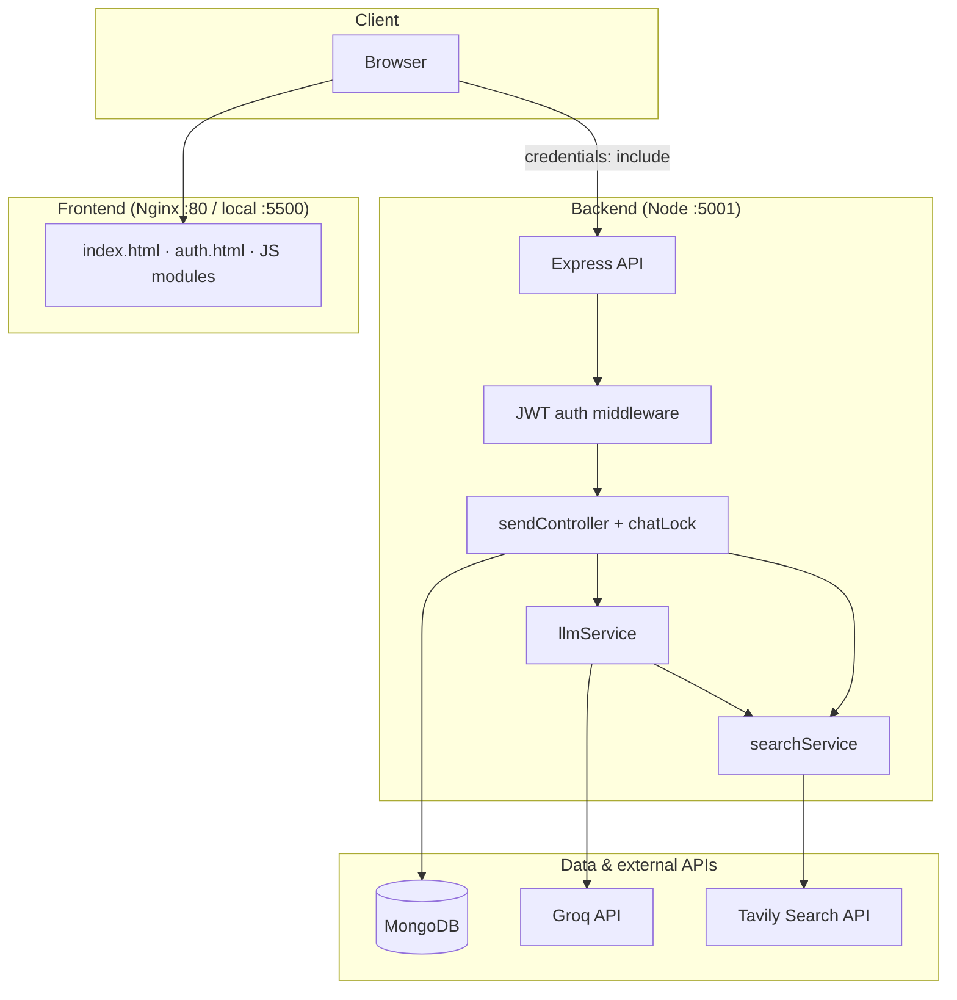
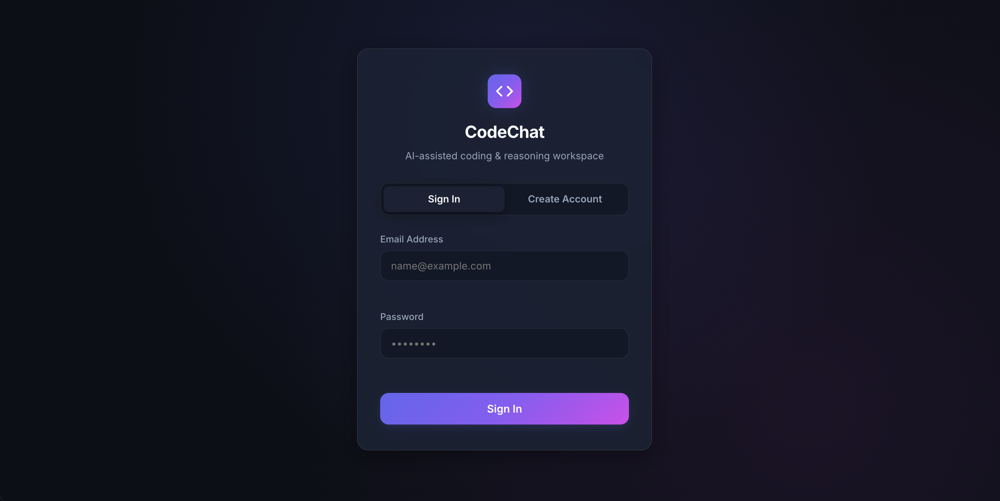
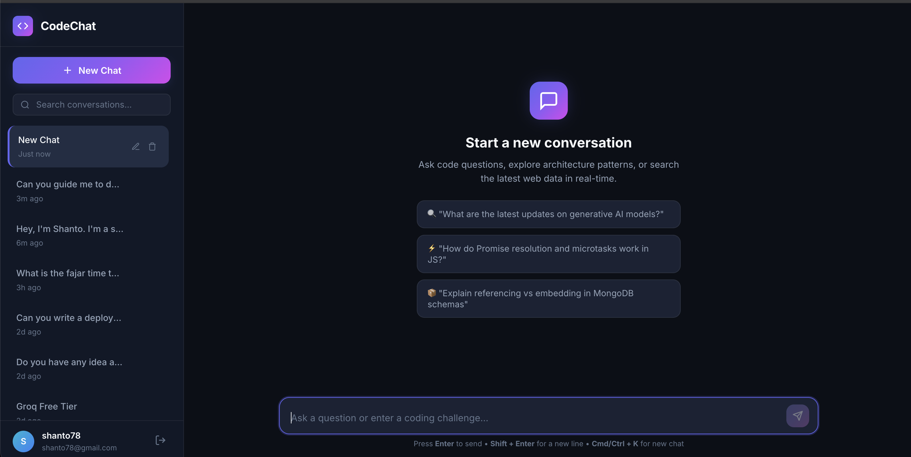

# CodeChat

A full-stack AI chat application for developers: sign in, manage conversations, and chat with an assistant backed by **Groq** completions and optional **Tavily** web search for up-to-date answers.

---

## Project overview

CodeChat is a monorepo with three main parts:

| Layer | Location | Role |
|--------|-----------|------|
| **Frontend** | `frontend/` | Static HTML/CSS/JS UI (auth, sidebar, markdown chat, mobile layout) |
| **Backend** | `backend/` | Express + TypeScript REST API, JWT session cookies, MongoDB persistence |
| **Infrastructure** | `docker-compose*.yml`, `.github/workflows/` | Local/prod containers and CI/CD to Docker Hub + AWS EC2 |

Core user flows:

1. **Auth** — Sign up / sign in; JWT stored in an HTTP-only cookie.
2. **Chats** — Create, rename, search, and delete conversations scoped per user.
3. **Send** — User message is saved, history is sent to Groq; when the model calls `web_search`, Tavily results are fetched and a second completion produces the final reply.
4. **Display** — Assistant replies render as sanitized Markdown (code blocks, tables, copy button).

---

## Architecture diagram



**Request path for `/api/chats/:id/send`**

1. Validate user owns the chat; acquire per-chat lock (avoid overlapping sends).
2. Persist user message; optionally auto-title the chat.
3. Call Groq with tools; if `web_search` is invoked, run Tavily and append tool messages.
4. Second Groq call (synthesis) produces the concise assistant reply shown in the UI.
5. Persist assistant (and tool) messages; return JSON to the client.

---

## Tools used

### Application

| Category | Technology |
|----------|------------|
| Runtime | Node.js 22, TypeScript |
| API | Express, Zod validation, express-rate-limit |
| Database | MongoDB 7, Mongoose |
| Auth | bcrypt, JWT, cookie-parser |
| LLM | groq-sdk (Groq chat completions + function calling) |
| Search | @tavily/core |
| Security | Helmet, CORS with credentials |
| Frontend | Vanilla HTML/CSS/ES modules, Marked, DOMPurify |
| Frontend server | Nginx (Docker prod image) |

### DevOps

| Category | Technology |
|----------|------------|
| Containers | Docker, Docker Compose |
| CI/CD | GitHub Actions (build, typecheck, integration tests, Docker push) |
| Registry | Docker Hub |
| Deploy | AWS EC2 via AWS Systems Manager (SSM) `send-command` |

---

## Setup instructions

### Prerequisites

- Node.js **22+** and npm
- MongoDB **7** (local install or Docker)
- [Groq API key](https://console.groq.com/) (optional: `mock_*` keys enable mock completions in CI)
- [Tavily API key](https://tavily.com/) (optional for mock search in dev/CI)

### 1. Clone and configure backend

```bash
git clone <your-repo-url> codeChat
cd codeChat/backend
cp .env.example .env
```

Edit `backend/.env`:

- `MONGODB_URI` — e.g. `mongodb://localhost:27017/chatbot`
- `JWT_SECRET` — at least 32 characters
- `CORS_ORIGIN` — exact frontend origin (e.g. `http://localhost:5500`)
- `GROQ_API_KEY`, `GROQ_MODEL`, `TAVILY_API_KEY` — your keys

### 2. Run backend (development)

```bash
cd backend
npm ci
npm run dev          # nodemon + ts-node on PORT (default 5001)
```

Or build and run production-style:

```bash
npm run build
npm start
```

Health check: `http://localhost:5001/api/health`

### 3. Run frontend (development)

Serve static files over HTTP (do **not** open `index.html` as `file://`):

```bash
cd frontend
npx --yes serve . -p 5500
```

Open `http://localhost:5500` → sign up on `auth.html` → use the chat UI.

If the API is not on `http://<same-host>:5001/api`, set before loading scripts:

```html
<script>window.CODECHAT_API_URL = 'http://localhost:5001/api';</script>
```

### 4. Run everything with Docker Compose (local)

Ensure `backend/.env` exists, then from the repo root:

```bash
docker compose up --build
```

| Service | URL |
|---------|-----|
| Frontend | http://localhost:5500 |
| Backend | http://localhost:5001/api |
| MongoDB | localhost:27017 |

### 5. Integration tests (optional)

```bash
cd backend
npm run build
# Start MongoDB and API with .env configured, then:
npm run test:integration
```

CI runs typecheck (`npm test`) and integration tests against mock Groq/Tavily keys.

---

## Deployment steps

Production uses **pre-built images** from Docker Hub and **docker-compose.prod.yml** on an EC2 instance, triggered from GitHub Actions on pushes to `main`.

### One-time server setup (EC2)

1. Install Docker and Docker Compose plugin on the instance.
2. Install/configure **SSM Agent** so the instance accepts `AWS-RunShellScript` commands.
3. Place secrets on the server: `backend/.env` under your app directory (not committed to git).
4. Open security group ports as needed (e.g. **5500** frontend, **5001** API, or put a reverse proxy in front).

### GitHub configuration

**Secrets**

| Secret | Purpose |
|--------|---------|
| `DOCKERHUB_USERNAME` | Docker Hub user |
| `DOCKERHUB_TOKEN` | Docker Hub access token |
| `AWS_ACCESS_KEY_ID` | Deploy IAM user |
| `AWS_SECRET_ACCESS_KEY` | Deploy IAM user |

**Variables (repository or environment)**

| Variable | Example | Purpose |
|----------|---------|---------|
| `AWS_REGION` | `us-east-1` | AWS region |
| `EC2_INSTANCE_ID` | `i-0abc...` | Target instance |
| `EC2_APP_DIR` | `/opt/codechat` | Deploy directory on EC2 |
| `DOCKERHUB_BACKEND_IMAGE` | `codechat-backend` | Optional image name override |
| `DOCKERHUB_FRONTEND_IMAGE` | `codechat-frontend` | Optional image name override |

### Pipeline (on push to `main`)

1. **build** — compile backend TypeScript  
2. **test** — typecheck + integration tests with MongoDB service  
3. **docker-build** — build and push backend/frontend images (SHA tags)  
4. **docker-push** — promote images to `:latest`  
5. **deploy** — SSM runs on EC2: login to Docker Hub, `docker compose -f docker-compose.prod.yml pull`, `up -d`

### Manual production deploy

On the server (with env vars set):

```bash
export DOCKERHUB_USERNAME=youruser
export IMAGE_TAG=latest
cd /opt/codechat   # your EC2_APP_DIR
docker login
docker compose -f docker-compose.prod.yml pull
docker compose -f docker-compose.prod.yml up -d
```

Set `CORS_ORIGIN` in `backend/.env` to your public frontend URL. If the API hostname differs from the page hostname, configure `window.CODECHAT_API_URL` in the frontend build or inject it at deploy time.

Set `TRUST_PROXY=1` when serving the API behind a reverse proxy/load balancer.

---

## Screenshots

| Sign in | Chat workspace (empty state) |
|---------|------------------------------|
|  |  |

Additional captures can go in [`docs/screenshots/`](docs/screenshots/).

---

## Problems faced

| Problem | What we did |
|---------|-------------|
| **CORS + cookies** | Session uses HTTP-only cookies; browser requires matching origins and `credentials: 'include'`. Dev allows any `localhost` port; production requires exact `CORS_ORIGIN`. |
| **Two-step LLM + search** | Groq tool calls require persisting tool messages, injecting Tavily text, then a synthesis completion—easy to get wrong message order or duplicate assistant rows. |
| **Verbose answers** | Default “helpful” model behavior and loose synthesis prompts produced long replies; tightened `SYSTEM_PROMPT` / `SYNTHESIS_PROMPT` and lowered temperature. |
| **Concurrent sends** | Rapid sends on one chat could race; added per-chat locking in `chatLock.ts`. |
| **CI without paid API keys** | Integration pipeline uses `mock_groq_key` / `mock_tavily_key` so tests run without billing real providers. |
| **Deploy drift on EC2** | Shipping `docker-compose.prod.yml` via SSM base64 keeps the server compose file aligned with the repo tag being deployed. |

---

## What you learned

- **Tool-augmented chat**: Designing a reliable loop (completion → tool execution → follow-up completion) and storing the full turn history in MongoDB for replay.
- **Prompt and sampling tradeoffs**: System prompts and temperature materially affect answer length and precision, especially after web search snippets.
- **Secure SPA-style auth without a framework**: JWT in cookies, Zod on inputs, rate limits on `/send`, Helmet and sanitized Markdown on the client.
- **Containerized full stack**: Multi-stage backend Dockerfile, Nginx static frontend image, healthchecks and `depends_on` in Compose.
- **End-to-end CI/CD**: Build artifacts, integration tests against a real HTTP server, immutable image tags, and remote deploy through AWS SSM instead of SSH keys in Actions.

---

## Repository layout

```
codeChat/
├── backend/          # Express API, models, Groq/Tavily services
├── frontend/         # Static UI (see frontend/README.md for UI-only notes)
├── docs/screenshots/ # Add marketing / portfolio screenshots here
├── docker-compose.yml
├── docker-compose.prod.yml
└── .github/workflows/ci-cd.yml
```

## License

Add your license here if applicable.
